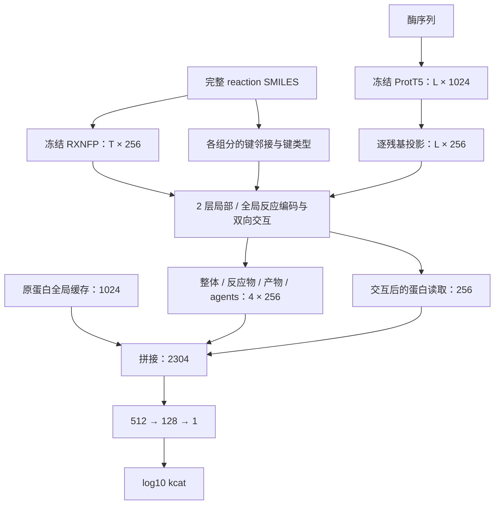

# 预训练反应 token 与酶残基的交互模型

本分支从 `main` 的 `e737c813ffc15a538f7d68effc9ccd6de0d6b169` 新建，仅增加独立文件。
原图模型、原训练入口及已有实验文件保持原版本。入口为：

```bash
python -m newkcat.interaction --help
```

## 1. 这次改的是什么

当前 R 先把随机初始化的字符 Transformer 输出池化，再与蛋白全局向量融合。
这个版本让**完整的预训练反应 token 和逐残基蛋白状态在池化之前交互**，
并把分子内键连接作为化学编码的结构约束。它是一个新的化学编码与交互模型，
不是在 MolT5 / MACCS 后追加 64 维底物图向量。

采用的输入：

- 酶：冻结 ProtT5 的逐残基状态 `[L, 1024]`。
- 反应：冻结 RXNFP 的完整 token 状态 `[T, 256]`，不是单个 CLS 指纹。
- 拓扑：分别从各反应组分的 SMILES 取得分子内键连接，不需要原子映射。
- 蛋白全局路径：可逐值复用原有 `sample_ids + protein` 缓存 `[1024]`。
  不提供该缓存时，明确使用所有新残基状态的均值。训练与预测必须使用同一种来源。

这个模型需要已知反应物和产物。它不把未知产物预测出来，也不应与只知酶和底物的使用场景混称。

## 2. 完整结构



默认配置的可训练参数：**4,940,601**。两个预训练底座在特征提取阶段冻结，
不进入优化器。默认回归输入为 `1024 + 4×256 + 256 = 2304`。

### 一个交互块的内部

设反应状态为 `H[T,256]`，蛋白残基为 `E[L,256]`：

1. **化学全局注意力**：所有有效反应 token 可以互相读取。
2. **化学局部注意力**：有可靠拓扑的原子 token 只读取自身及其成键邻居，
   键型作为每个 attention head 的 bias。默认类型为 self / single / double /
   triple / aromatic / other；这不是逐键变化标签，也没有伪造两侧的原子对应关系。
3. **双向多位置交互**：

   ```text
   反应更新 = Attention(Q=H, K=E, V=E)
   蛋白更新 = Attention(Q=E, K=H, V=H)
   ```

   两个方向同时使用交互前的状态；蛋白方向具有 T 个化学 key。
4. 两侧各有 FFN 残差更新。

所有更新使用 Pre-LayerNorm、残差和可训练的逐通道尺度，初值为 `0.1`。
这些是训练起点，不是已经证明能消除 seed 波动的措施。

第二层化学消息交换会接收第一层已经由酶参与更新的状态。酶并非仅在最终池化时出现。
特殊字符、括号和反应分隔符仍保留全局与跨模态路径；局部路径只作用于可靠的原子拓扑。

### 读出与维度

| 路径 | 形状 | 行为 |
|---|---:|---|
| ProtT5 原始残基缓存 | `L × 1024` | 保留每个残基位置 |
| 蛋白交互通道 | `L × 256` | 每个残基投影，不是整条蛋白压成一个 256 向量 |
| 蛋白全局直接路径 | `1024` | 原值进入回归输入 |
| RXNFP 输出 | `T × 256` | 预训练底座原生宽度；没有从 512 压到 256 |
| 反应角色读出 | `4 × 256` | 整体、反应物、产物、agents 各一个读取向量 |
| 蛋白读出 | `256` | 从交互后的全部残基读取 |
| 回归 | `2304 → 512 → 128 → 1` | 一个标量，默认训练时标准化目标，输出时反变换 |

空的 agents 集合返回严格零向量，不经过偏置生成虚构的试剂信息。
`A>>B` 中没有单独 agents；`A>agents>B` 会保留三侧角色。

不将 `T×256` 直接展平为固定位置向量。分组读出发生在多层上下文编码和跨模态交互之后，
并不等于对原始字符直接求平均。若把 2048×256 展平后连接 512 神经元，
这一层就需约 2.68 亿个权重；本模型的 2304→512 层约 118 万个权重。

## 3. 方法来源与边界

- [Retroformer，ICML 2022](https://proceedings.mlr.press/v162/wan22a/wan22a.pdf)：
  借鉴 **encoder** 中分子一跳局部邻接与全局上下文并存的思想。
  原文 encoder 的局部头不是反应中心 mask；反应中心限制出现在其 decoder。
  本实现采用键型 attention bias 和残差适配层，不是原论文的逐层逐式复现。
- [RXNFP 官方实现](https://github.com/rxn4chemistry/rxnfp)：
  使用现成 BERT token states。`bert_ft` 和 `bert_pretrained` 都可指定，
  第一轮建议选与现有 MCKcat 相同的 checkpoint 以便比较。
  checkpoint 路径、配置、文件 SHA256 和 tokenizer 来源都会记录。
- [MCKcat 原文](https://advanced.onlinelibrary.wiley.com/doi/10.1002/advs.77789)
  与 [官方代码](https://github.com/gefengya/MCKcat/blob/master/code/MCKcat/MCKcat_model.py)：
  官方模型保留蛋白局部窗口，但反应先压成单个 256 维 CLS。
  本模型让化学侧也保留多个位置，并在池化前加入化学拓扑与残基交互。
- [KcatNet](https://doi.org/10.1186/s13059-026-03986-3) 和
  [ERBA 预印本](https://arxiv.org/html/2603.12845v1) 已有分层交互或池化前的化学—蛋白条件化。
  因此不能把“交叉注意力”“局部与全局”或“池化前融合”本身称为首次。

需要检验的假设是：**完整反应的预训练位置表示、化学键拓扑和池化前残基交互，
是否共同改善动力学预测。** 当前实现没有证明优于 MCKcat，也没有证明注意力对应真实催化机制。
净反应拓扑不是过渡态结构，注意力也不是原子映射。

## 4. 保留全部原记录的输入政策

直接复用现有 `samples.csv` 的以下列：

```text
sample_id,sequence,smiles,reaction_smiles,log10_kcat,split
```

`split` 为 `train / val / test`，可带已有 `group_id` 等列。
使用原来的 24,590 行和 cluster40 划分文件即可；程序不重新划分、不删除转换失败行，
不使用 `sr_smiles` 或中心转换状态来筛选。这里是程序行为约定，并非本环境已经处理了用户完整数据的声明。

| 情况 | 实际处理 |
|---|---|
| 原子映射或 CGR 转换失败 | 不依赖这些输入，仍编码原 reaction SMILES |
| `*` / `[*:n]` | 保留为 wildcard；支持时作为 RDKit dummy 原子建立拓扑；未知结构本身没有被补全 |
| 某个组分不能被 RDKit 解析 | 只关闭该组分的局部拓扑路径；全部 token 仍进入同一个预训练序列与全局交互路径 |
| RXNFP 词表没有某个 token | 保留其位置，以 `[UNK]` 编码并记录 token/位置，不假装其化学含义已知 |
| 超过 RXNFP 的 512 个位置 | 使用有效载荷 510、重叠 128 的窗口；对重叠 token 的状态求均值，覆盖全部 token |
| 长蛋白 | 默认每窗 1000 残基、重叠 128，合并后仍保留完整序列长度 |
| 缺少 reaction_smiles 或蛋白缓存与序列长度不符 | 报出具体样本 ID；不删行、不用随机矩阵、不把全局向量复制成假残基 |

**分窗不是等价的全长预训练 attention。** 窗口内可能没有完整反应上下文；
跨窗口信息由上层交互网络补充。这是新设计的限制，不能称作预训练模型的原生长序列能力。

对所有标准词法字符保留原始 span。对于反应中作为配位键的 `->`，不会把其中的 `>`
误算成反应两侧分隔符。三段反应的单个 `>` 若不在所用 RXNFP 词表内仍会是 UNK，
但其角色边界由解析器显式保留。

### 旧缓存可以复用到什么程度

- 原 CataPro 的 `protein[1024]` 可通过 `--global-features` 精确按 ID 复用。
- MCKcat 的**完整、逐残基** ProtT5 矩阵可以显式导入。
- 已平均池化的 1024 维向量无法还原逐残基信息；256 维 RXNFP 指纹也无法还原 token states。
- 如果旧 MCKcat 对长酶只保留前后各 500 残基，该矩阵不能冒充完整长序列状态，
  需要用完整窗口提取器重新生成对应蛋白。这是提取新特征，不是删掉这条动力学记录。

## 5. 安装与运行

### 环境

```bash
python -m pip install -e '.[test]'
python -m pip install -r requirements-interaction.txt
```

第二步只在需要提取预训练特征的环境安装。训练已生成的缓存只需要原项目的依赖。
本轮本地兼容性测试使用 PyTorch 2.7.1、Transformers 4.57.6、SentencePiece 0.2.2。
GPU 版本需安装与机器 CUDA 环境对应的 PyTorch。

### A. 准备现成权重

RXNFP checkpoint 目录需要 `config.json`、`vocab.txt` 和 `pytorch_model.bin` 或
`model.safetensors`。可以直接使用 MCKcat 环境中已安装的 RXNFP 权重目录。

已实际加载验证的公开版本：

- [RXNFP bert_ft，固定版本 6fd48f4](https://github.com/rxn4chemistry/rxnfp/tree/6fd48f4927c2178555cc5d71dbfb225fb178f43c/rxnfp/models/transformers/bert_ft)
- 12 层、hidden 256、4 heads、FFN 512、最大位置 512、词表 591。
- 权重文件 26,743,150 bytes；SHA256：
  `5bb7f9f5831ec16a4b90545f95394853caf19ff9a8272291c86e0b231e0ff2ba`。

这里不把权重复制进项目 git，也不要求升级旧 `rxnfp` 包。
新的加载器直接用 Transformers 加载其 BERT backbone，并拒绝缺失关键层的 checkpoint。

### B. 一次性提取特征

以下绝对路径需换成你机器上的实际路径：

```bash
python -m newkcat.interaction cache \
  --samples /path/to/existing/samples.csv \
  --reaction-checkpoint /path/to/rxnfp/bert_ft \
  --protein-model /path/to/ProtT5 \
  --device cuda:0 \
  --output /path/to/interaction_cache
```

默认只读已有本地权重。只有显式加 `--allow-model-download`，蛋白模型 ID 才允许联网下载。
相同酶序列和相同反应分别只提取一次。中断后同一命令可以复用已完成、来源匹配的 NPZ。
完整 `index.json` 在所有行准备成功后发布。

如果已有合适的完整残基缓存，可替换蛋白提取参数：

```bash
python -m newkcat.interaction cache \
  --samples /path/to/existing/samples.csv \
  --reaction-checkpoint /path/to/rxnfp/bert_ft \
  --protein-import-index /path/to/protein_import/index.json \
  --device cuda:0 \
  --output /path/to/interaction_cache
```

导入 index 的格式为：

```json
{
  "version": 1,
  "encoders": {"protein": {"name": "实际来源模型和提取设置"}},
  "sequences": {
    "完整规范化酶序列的SHA256": {
      "path": "proteins/example.npz",
      "array_key": "states"
    }
  }
}
```

每个 NPZ 内是 `[完整序列长度,1024]` 的真实残基矩阵，不能是全局向量或截断后的假全长。
文件路径相对于导入 index 所在目录；可额外给出文件 `sha256`。
也可以用此前生成的 interaction cache 的 `index.json` 导入蛋白。
同时给模型与部分导入 index 时，两者的 encoder 来源 metadata 必须一致。

缓存按去重序列和反应写入单独 NPZ，训练以有界 LRU 读取。
残基缓存比原全局缓存大得多：例如 500×1024 个 float32 值未压缩约 2 MB / 酶。
需要按实际唯一酶数预留磁盘和 I/O 预算。

### C. 查看结构并训练主模型

```bash
python -m newkcat.interaction describe \
  --config configs/interaction/pretrained_interaction.yaml

python -m newkcat.interaction train \
  --config configs/interaction/pretrained_interaction.yaml \
  --samples /path/to/existing/samples.csv \
  --cache /path/to/interaction_cache \
  --global-features /path/to/existing/features.npz \
  --device cuda:0 --seed 668 \
  --output /path/to/runs/interaction_seed668
```

`features.npz` 只需 `sample_ids` 与 `protein`，可直接使用同时带 MolT5、MACCS 的旧 NPZ；
额外数组不会进入新模型。

默认训练设置：batch 1、累计 8 个样本更新、AdamW 3e-4、weight decay 1e-4、
gradient clip 1、dropout 0.1、最多 100 轮、验证早停 patience 15。
目标均值与标准差只用训练标签拟合，验证和预测均反变换回 `log10(kcat)`。
按整个验证集 RMSE 选权重；同一验证集上这与最大 R² 选模等价。

这些是可运行的起始设置，并非已选择出的最佳超参数；也不同于用户此前 MCKcat 的训练协议。
模型不依赖 BatchNorm。最后不足 8 个样本的累积窗口按真实样本数归一化，不丢尾批。

### D. 独立评估

```bash
python -m newkcat.interaction evaluate \
  --config configs/interaction/pretrained_interaction.yaml \
  --samples /path/to/existing/samples.csv \
  --cache /path/to/interaction_cache \
  --global-features /path/to/existing/features.npz \
  --checkpoint /path/to/runs/interaction_seed668/best.pt \
  --split test --device cuda:0 \
  --output /path/to/runs/interaction_seed668_test
```

训练不会实例化测试集数据或解析测试标签。评估必须使用完成并锁定的 checkpoint，
以及原始记录、顺序和缓存。`predict` 使用相同参数格式，可以 `--split all`，且完全不读取标签。
每次正式运行使用新的 output 目录；入口拒绝覆盖已有运行。

## 6. 实现文件

| 文件 | 作用 |
|---|---|
| `src/newkcat/interaction/chemistry.py` | token span、角色、原子与分子内拓扑对应 |
| `src/newkcat/interaction/encoders.py` | 真实 RXNFP / ProtT5 加载、冻结、完整窗口合并 |
| `src/newkcat/interaction/data.py` | 去重缓存、显式残基导入、按 ID 读取与 padding |
| `src/newkcat/interaction/model.py` | 局部 / 全局化学更新、池化前双向交互、角色读出 |
| `src/newkcat/interaction/runner.py` | 训练、累积梯度、选模、完成权重与独立预测 |
| `src/newkcat/interaction/cli.py` | 独立命令入口 |
| `configs/interaction/pretrained_interaction.yaml` | 主模型起始配置 |

`use_topology` 和 `use_cross_attention` 只用于随后有明确目的的对照实验。
先运行主模型，不需要先做另一轮中心审计或把十个宽度变体全部跑完。

## 7. 已验证与尚未验证

已经验证：

- 本分支全套 **276 项测试通过**，其中 65 项针对新增模型、缓存、编码器与训练流程；Ruff 通过。
- 官方 RXNFP 权重可以加载；普通、映射、wildcard 和长反应能返回逐 token 状态。
- 一条 1201-token 反应由三个窗口覆盖，输出 1201×256，所有数值有限。
- 真实官方 tokenizer 对普通、环/分支、带电、wildcard 等输入与新词法器的 token / ID 一致；
  新实现对原子映射和未匹配字符另有显式处理。
- 修改残基会影响池化前的反应状态，修改反应也会影响池化前的蛋白状态。
- 双向交互的 query / key / value 确有梯度；padding 和空角色处理正确。
- 微批次梯度累积与等效大 batch 的更新相符，包括尾批。
- 小型合成数据通过训练、验证选模、checkpoint 重载和独立预测。
- 用真实 RXNFP 权重和明确标为合成的蛋白 fixture 走通 `cache` CLI 的残基导入、
  12 行缓存生成、按原 split 加载和新模型前向；这只验证接口，不构成真实动力学实验。

尚未在这里完成：用户 24,590 行的全量新残基/token 特征提取、正式 kcat 训练、
多 seed 性能比较，以及真实 ProtT5 大权重的本地提取运行。
因此不能把代码测试结果当作超过 R / CataPro / MCKcat 的实验证据。

### 本地最小运行检查

```bash
python examples/make_interaction_demo.py --output /tmp/interaction-demo
python -m newkcat.interaction train --config /tmp/interaction-demo/config.yaml
python -m newkcat.interaction evaluate \
  --config /tmp/interaction-demo/config.yaml \
  --checkpoint /tmp/interaction-demo/train_run/best.pt \
  --output /tmp/interaction-demo/test_result
```

这个 demo 的特征和标签是**明确标注的合成测试夹具**，只用于验证代码流程，
不会由生产 `cache` 命令作为任何样本的缺失特征回退。
