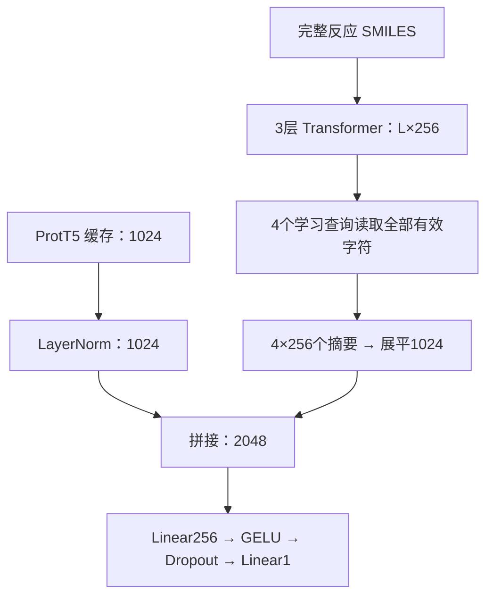

# 完整反应 R 模型：蛋白瓶颈、读出与融合的独立对照

分支：`feat/reaction-readout-ablation`。

本分支从 `main` 的 `e737c813ffc15a538f7d68effc9ccd6de0d6b169` 建立，
**只新增文件**。原有模型、CLI、配置、README 和 CI 文件均保留。
`src/newkcat/sequence/` 从先前序列分支提交
`abe40d643b37e39fbca54fa712642a04b4e6683c` 继承，提供相同的字符编码器、
数据契约和反应准备流程；新实验在 `src/newkcat/readout/`。

这是一组可运行的研究对照，不是已经证实优于 CataPro 或 MCKcat 的新方法。
新模型使用完整普通 reaction SMILES，保持所有样本、标签、原划分和 ProtT5 缓存。
不以原子映射或 sr 转换是否成功筛除记录，不使用 MolT5、MACCS 或原图分支。

## 1. 先回答三个设计问题

### 蛋白为什么一定要 1024→256？

不必如此。原 256 维是共同投影空间的工程选择，尚未证明最优。
拼接允许不同维度；注意力中 Query/Key 的对齐也不要求放弃完整蛋白直接路径。

`protein_readout: full` 保留 LayerNorm 后的 1024 维，移除提前的线性降维。
它并不撤销归一化，也不承诺无损保留所有统计量。
默认 R 参数为 1,037,697；仅做此改动后为 **971,393**，因为移除蛋白投影
省下的参数比扩大回归头输入所增加的参数更多。

不要把 `head_dim` 简单改成 1024 来代替该消融：那也会改变回归隐藏宽度。

### 化学均值池化为什么可能不足？

原路径是 `L×128 → mean128 → Linear/GELU/LN256`。最后升维只是非线性展开，
不能恢复均值已经合并的信息。不过 H 是含位置和全局上下文的 Transformer 输出，
不能声称它等同于没有顺序信息的原始字符袋。

本分支独立控制每个字符的通道数 `d_model`，以及怎么从 L 个字符读取信息。

### 为什么不直接把所有字符展平？

可以，提供 `readout: flatten`。它按声明的 `max_length` 补零，固定维度；
不按当前 batch 长度改变权重形状，不裁剪超长输入。
若 Lmax=2048、d=256，和蛋白1024拼接再接256维隐藏层，第一层就有
`(2048×256+1024)×256+256 = 134,480,128` 个参数。
这还会把读出权重绑定在字符串位置上。即便 batch=1，也需要固定线性层的输入宽度。

`max_flatten_parameters` 在分配权重前检查第一层密集缩减的参数量，默认2000万。
大展平配置显式提高到1.5亿。`inspect-model` 使用 meta tensors，只统计、不分配这些大权重。

## 2. 模型及默认配置

所有配置保留3层化学 Transformer；d256/512的FFN分别为1024/2048。
所有输出为 `log10(kcat / s^-1)`，化学编码器默认随机初始化。

| 配置（configs/readout/） | 蛋白出口 | 化学宽度 | 读取 | 化学出口 | 作用 |
|---|---:|---:|---|---:|---|
| `r0.yaml` | 256 | 128 | mean | 256 | 新训练器的参考 R |
| `r_protein1024.yaml` | 1024 | 128 | mean | 256 | 单独去掉蛋白提前降维 |
| `r_width256.yaml` | 256 | 256 | mean | 256 | 单独增宽化学编码器及对应FFN |
| `r_mean_max.yaml` | 256 | 128 | mean+max | 256 | 简单的读出对照 |
| `r_queries4.yaml` | 256 | 128 | 4个学习查询 | 256 | 单独替换mean读出 |
| `r_full_queries256.yaml` | 1024 | 256 | 4个学习查询 | 1024 | 组合候选；摘要后不再提前压缩 |
| `r_full_queries256_conditioned.yaml` | 1024 | 256 | 酶条件化4查询 | 1024 | 可选的条件读取消融 |
| `r_full_queries256_fusion.yaml` | 1024 | 256 | 4查询＋融合Transformer | 1024 | 可选的融合消融 |
| `r_full_mean512.yaml` | 1024 | 512 | mean | 512 | 可选的更宽编码器探针 |
| `r_flatten256.yaml` | 1024 | 256 | 全序列固定长度展平 | 524288 | 大参数量的位置读出对照 |

这些是可选配置，不是要求一次启动十组训练。建议首先比较 R0、R-protein1024、
R-width256，并增加一个读取对照；用验证集决定是否组合有效因素。
测试集保持原有全量；如果反复根据已知测试结果设计方法，需要再用训练集内部的
cluster交叉验证、额外锁定划分或独立数据确认泛化，不把探索中的最高测试值当成无偏结论。

### 可学习的多个摘要



查询可以学习不同的信息，但没有预先指定“中心/辅因子/远端/产物”等化学角色，
也不保证四个摘要互不重复。它们读取的是带上下文的字符，仍不是原子或催化残基。
这是受注意力池化启发的简化实现，不是完整 Set Transformer 的复现。

`chemical_dim: null` 表示完全跳过化学投影，使K×d个摘要通道直接进入联合回归。
`condition_queries: true` 用一个独立的蛋白小投影修正查询，同时保留原1024维到回归头。
`fusion: transformer` 在蛋白token和K个反应摘要之间做注意力；融合后的K个化学摘要
与完整蛋白直接路径拼接，不把全局蛋白均值向量冒充成残基序列。

## 3. 安装与最小运行

建议独立检出，避免干扰已有实验目录：

```bash
git clone --branch feat/reaction-readout-ablation https://github.com/LuckyBreeze/newkcat.git newkcat_readout
cd newkcat_readout
python -m pip install -e '.[test]'
python -m newkcat.readout --help
python -m newkcat.readout inspect-model --config configs/readout/r_protein1024.yaml
```

R训练及普通反应准备不依赖 sr-smiles。若另外需要sr准备/诊断，才安装：

```bash
python -m pip install -r requirements-readout.txt
```

原 `newkcat` 命令仍负责旧图模型。新分支入口是 `python -m newkcat.readout`；
继承的反应准备入口是 `python -m newkcat.sequence prepare`。

### 先跑合成端到端检查

```bash
python examples/make_readout_demo.py
python -m newkcat.readout validate --config runs/readout_demo/queries_full.yaml
python -m newkcat.readout train --config runs/readout_demo/queries_full.yaml
python -m newkcat.readout evaluate \
  --config runs/readout_demo/models/queries_full/config.resolved.yaml \
  --checkpoint runs/readout_demo/models/queries_full/best.pt \
  --split test --output runs/readout_demo/evaluation
```

此示例包含通配原子、变长字符串、重排的ID缓存和不能整除累积步数的训练行。
标签与蛋白向量都是随机合成数据，示例指标没有生物学意义。

## 4. 接入现有24,590行数据

已经准备好的 `samples.csv`、`coverage.json`、`reaction_provenance.jsonl` 保持在一起。
`features.npz` 继续用现有缓存；通过sample_id连接，序列实验只读取protein数组。
**不需要重新计算ProtT5，也不需要删除旧缓存中的MolT5/MACCS。**

```bash
python -m newkcat.readout validate \
  --config configs/readout/r_protein1024.yaml \
  --samples /absolute/prepared/samples.csv \
  --features /absolute/cache/features.npz

python -m newkcat.readout train \
  --config configs/readout/r_protein1024.yaml \
  --samples /absolute/prepared/samples.csv \
  --features /absolute/cache/features.npz \
  --seed 668 --device cuda \
  --output /absolute/new_runs/r_protein1024_seed668
```

路径是占位符，替换为实际现存数据路径；命令不会复制或重写输入表。
若直接使用前次C/C-L混合输入的准备结果，R也会对sr成功与回退记录统一读取普通
reaction SMILES。来源状态仍记录，供相同样本上的诊断使用。

若只有源反应表，普通反应准备无需原子映射：

```bash
python -m newkcat.sequence prepare \
  --samples /absolute/source/samples.csv \
  --reaction-only --output /absolute/prepared_r
```

这个模式不会自动猜产品。完整反应文本缺失、解析失败、超长或缓存ID不匹配都会
明确报错，不能静默删行或用未知化学内容替代。

### 训练与评估边界

- 默认batch1、AdamW、lr1e-4、weight_decay1e-4、150轮上限、patience20、seed668。
- 默认梯度累积1，保持单样本更新。若更改 `grad_accum_steps`，需要作为单独训练协议比较；
  代码按窗口内实际样本数加权，最后不满窗口也正确处理。不是增加batch后仍宣称协议相同。
- 全验证集RMSE选择checkpoint；固定同一验证标签时，与最大化R²等价。
- 拟合不实例化测试样本，不用测试指标早停。推断要求训练已完成的锁定checkpoint。正式evaluate还核对原split的完整ID及顺序，
  并要求samples/features内容哈希与训练时一致；新样本使用predict。
- 保存解析后的配置、数据hash、训练/验证身份、覆盖率、参数量及每轮访问行数。
- 默认不覆盖已有输出目录。实际新模型训练结果必须独立记录，不能沿用旧R的成绩。

模型锁定后：

```bash
python -m newkcat.readout evaluate \
  --config /absolute/new_runs/r_protein1024_seed668/config.resolved.yaml \
  --checkpoint /absolute/new_runs/r_protein1024_seed668/best.pt \
  --split test --device cuda --output /absolute/new_runs/r_protein1024_test
```

旧R模型的state_dict与默认新R0结构兼容，测试覆盖同seed的逐值初始化和前向一致。
但实验checkpoint的metadata契约不同，CLI不把旧checkpoint静默当成新的实验产物。

## 5. 先解释C/C-L的退化：不重训的分组审计

先前C/C-L输入混合sr与普通反应，两个格式的比例可能随划分变化。
先按**同一个样本表**对R、C、C-L分组，检查成功组和回退组分别发生了什么。

```bash
python -m newkcat.readout audit \
  --samples /absolute/prepared/samples.csv --split test \
  --prediction R=/absolute/R/predictions.csv \
  --prediction C=/absolute/C/predictions.csv \
  --prediction CL=/absolute/CL/predictions.csv \
  --group-column group_id --bootstrap-repetitions 2000 \
  --output /absolute/new_runs/existing_models_status_audit
```

验证集也应做相同审计，使用 `--split val` 和对应预测表。
预测表需要sample_id、prediction、target（或不歧义的y_pred/y_true）；可显式指定列名。
工具拒绝ID缺失、额外行、重复行、标签不一致以及非有限数值。
**所有模型使用manifest的reaction_status分组**，不按各模型自己的状态重新分组。

不传 `--prediction` 时，工具只检查覆盖率、标签分布、长度与动态字段统计。

输出：

- `audit.json`：完整汇总、输入hash及统计口径；
- `group_coverage.csv`：各组行数与分布；
- `model_metrics.csv`：全量及每组指标；
- `paired_differences.csv`：同样本上的模型误差差与可选cluster bootstrap；
- `joined_predictions.csv`：保持manifest原顺序的核对表。

整体MSE可按组样本权重分解，RMSE不能直接按权重相加。
Bootstrap衡量这些固定预测在样本/簇抽样下的差异，不代替训练种子不确定性。
只有一个cluster时不会输出伪装成有效的cluster置信区间。

审计用于解释已经观察到的结果，不用于剔除难样本、改测试标签或在测试集拟合校准。

## 6. 从逆合成迁移什么，当前分支又实现了什么

本分支先检验蛋白瓶颈、化学容量、读出方式与融合方式，**没有实现Retroformer图邻接头**。
不应把多查询池化单独包装成全新的逆合成算法。

后续真正值得迁移的编码机制：

1. **Retroformer**：编码器的local head利用分子图邻接和键特征，global head保留全局上下文；
   反应中心限制出现在decoder的局部cross-attention。两者不要混淆。
2. **LocalRetro**：对原子与键分别建表示，再用全局注意力更新；变化键的两端点、
   前后键类型及邻域可以作为明确的读取单位。
3. 对kcat回归，借用编码与读取机制即可，不需要照搬生成decoder、beam search或flow matching。

当前C-L选择动态字段的字符跨度，不等同于显式原子/键/催化残基配对。
如果下一步改成原子/键语义读出，需要真实token–atom对应和语义核验；这一点不能
仅靠把现有字符掩码扩大几个字符来满足。

参考原文：

- Set Transformer, ICML 2019: <https://proceedings.mlr.press/v97/lee19d.html>
- Retroformer, ICML 2022: <https://proceedings.mlr.press/v162/wan22a.html>
- LocalRetro, JACS Au 2021: <https://doi.org/10.1021/jacsau.1c00246>
- 继承代码与第三方许可见 [REACTION_READOUT_THIRD_PARTY_NOTICES.md](docs/REACTION_READOUT_THIRD_PARTY_NOTICES.md)。
