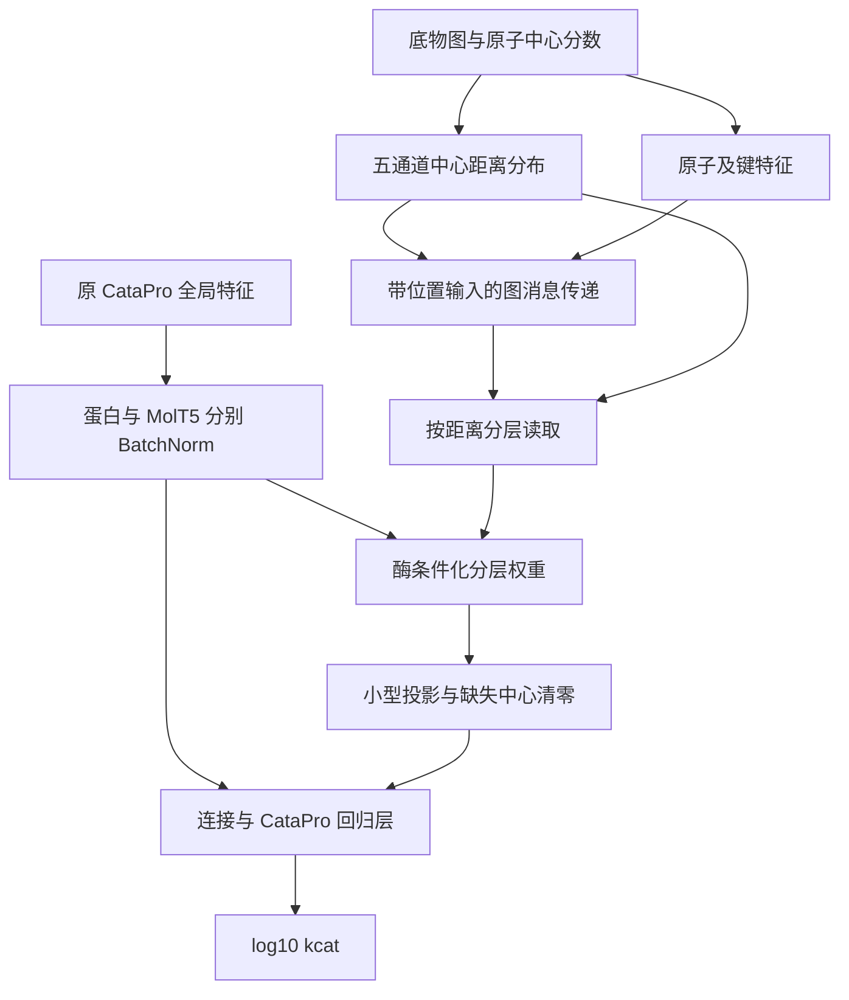

# 架构：从化学不变性出发，而不是堆叠模块

## 要检验的研究假设

在给定酶序列和底物的条件下，**底物原子相对于反应中心的局部及远端环境**可能比
单一整分子向量更容易被有限规模的 kcat 训练集利用。这是一个归纳偏置假设，必须通过
同数据、同信息条件的消融检验，不能由网络结构本身推出性能提升。

模型预测 `log10(kcat / s^-1)`。它没有把 kcat 直接等同于单步化学反应的活化势垒，
也没有使用 kcat/Km、Km 或热力学量构造额外物理约束。当前任务只做 kcat 回归。

## 数据流

图描述 `conditioned` 模式。MACCS 167 维保持原始二进制输入，不经过输入 BatchNorm。
酶条件化使用缓存的全局 ProtT5 向量；本版没有残基级 token 或原子–残基交叉注意力。

## 1. 图与中心需要同一个原子身份系统

图使用 RDKit 原子及键属性：元素、电荷、度、氢计数、杂化、芳香性、环、质量、
自由基，以及绝对 CIP 立体标签；键具有键类型、立体标签、共轭和环信息。
原子 160 维，键 16 维。图边为双向边，映射号永远不作为数值特征输入。

中心记录必须自带 `mapped_smiles`，`scores` 的键是其原子映射号。直接在该 SMILES
的顺序上构图并读取分数，避免通过“数组长度相同”假定原子对齐。
中心记录与样本底物必须具有相同结构、电荷、同位素和立体化学身份。

## 2. 用中心相对距离分布替代任意原子排序

设原子中心分数为 `p_j ∈ [0,1]`，距离 `d_G(i,j)` 为无向分子图最短跳数。
定义五个距离桶：0、1、2、≥3、不连通。

\[
\alpha_j=\frac{p_j}{\sum_k p_k},\qquad
\rho_{ir}=\sum_j\alpha_j\,\mathbf 1[d_G(i,j)\in B_r].
\]

只有中心可用且分数总和大于 `1e-8` 时才计算有效分布，否则置零。
对有效的真实原子，五个通道之和为 1。

这表示“按归一化分数抽取一个中心后，原子到该中心的距离分布”，
**不是到最近中心的距离概率**。当有多个中心时，同一原子可以在多个桶有非零权重。
分数归一化用于位置描述；原始分数的 `log1p(sum)`、最大值、均值另行保留。
这些统计量不是经过校准的映射正确率。

图距离也不是埃单位的三维距离，不能解释为结合构象、空间位阻或过渡态几何。

## 3. 在消息传递前加入位置

\[
h_i^{(0)}=W_x x_i + W_\rho\rho_i.
\]

之后每层采用边特征条件化的消息、按入度取平均、残差更新和 LayerNorm。
因此局部环境会在聚合时就受到中心位置影响，而不是在最后简单拼接一个中心指纹。
所有聚合对节点重编号等变，图级输出对节点重编号不变。

默认图隐藏维度 128、3 层。它是可复现的起点，不是优化完成的超参数结论。
实现使用 PyTorch `index_add_`，不需要 PyG 的二进制扩展。

## 4. 保留五个距离槽及其大小

\[
m_r=\sum_i\rho_{ir},\qquad
s_r=\frac{\sum_i\rho_{ir}h_i}{\max(m_r,\epsilon)}.
\]

`m_r` 是软分配质量，可能为非整数。每个槽将 `s_r` 和 `log1p(m_r)` 投影为 token，
再加上可学习的槽标识。空槽在投影与标识加入后重新清零，并参与注意力 mask。
保留质量信息是为了避免平均池化完全抹去该环境的规模。

`shell` 对有效槽给均匀权重，但仍将五个槽按固定语义位置连接，不把它们直接求和。
`conditioned` 用归一化后的酶向量产生 query：

\[
a_r=\operatorname{softmax}_r\left(
\frac{(W_q e)^\top W_k s'_r}{\sqrt{d}}\right).
\]

将 `a_r s'_r` 按五槽连接，与三项中心统计量一起投影为 64 维向量 `z`。
这使两种酶可以对相同底物的环境赋予不同权重，但不保证自动解决突变体 kcat 差异。
分层权重只是模型内部权重，不等同于催化因果解释。

## 5. 融合与严格的缺失处理

\[
\hat y=f_{\rm CataPro}[
\mathrm{BN}(e),\mathrm{BN}(m),\mathrm{MACCS},z].
\]

保留原 CataPro 的 256 维回归隐藏层，输出一个标量。
新增 `z` 在所有偏置、非线性及 LayerNorm 之后乘以中心可用标记；缺失或全零中心时
`z` 严格为零，避免偏置自己制造“中心特征”。

这种回退意味着同一扩展模型退回其全局特征路径；**不意味着它与单独训练的 baseline
参数完全相同**。只有用 `load_catapro_weights` 初始化且新增回归列为零时，才保证
`eval()` 预测与被加载的 CataPro 回归器一致。

## 6. 消融与可证伪的解释

| 比较 | 支持该假设需要观察到什么 | 若未观察到应如何解释 |
|---|---|---|
| global vs baseline | 单独增加图编码有帮助 | 不应先归功于反应中心 |
| center vs global | 中心定位带来额外收益 | 可能是中心质量低或任务不需要该先验 |
| shell vs center | 距离环境有额外收益 | 分层组织可能没有必要 |
| conditioned vs shell | 酶依赖的分层选择有帮助 | 全局查询未提供足够相关信息 |
| conditioned vs learned | 真实中心的结构优于无中心读取槽 | 可能只是更多容量/读取槽带来的收益 |
| 原中心 vs 固定权重打乱中心 | 预测对中心位置敏感且正确中心更好 | 可能没使用中心或主要依赖全局分支 |
| 训练全程打乱中心 vs 原中心 | 真实中心优于同容量噪声先验 | 不能仅凭测试时扰动称为因果证据 |

非 baseline 模式注册相同图模块，但实际启用的路径不同，**总参数相同不代表有效容量相同**。
应同时报告总参数、活跃路径、训练预算和多种子结果。固定权重中心审计已实现；
训练时扰动应生成单独中心文件、保持同一划分并重新训练，不反复查看测试集调整策略。

## 7. 与逆合成思想的关系

本项目迁移的是“反应中心是一种输入组织与读取先验”，不迁移生成器。

- [RetroDiT](https://proceedings.mlr.press/v306/wang26ln.html) 提供从反应中心组织表示的启发。
  这里使用图距离分布，既不对任意 SMILES token 排序，也不运行离散流匹配。
- [Retroformer](https://proceedings.mlr.press/v162/wan22a.html) 和
  [LocalRetro](https://pmc.ncbi.nlm.nih.gov/articles/PMC8549044/) 的局部/全局思路启发
  同时保留全分子路径与中心周围的环境。
- [Distance Encoding](https://papers.neurips.cc/paper_files/paper/2020/hash/2f73168bf3656f697507752ec592c437-Abstract.html)
  是图距离作为结构先验的重要已有工作。本仓库不把通用距离编码包装为全新基础方法。
- [CataPro](https://doi.org/10.1038/s41467-025-58038-4)
  提供基线特征与回归结构，原实现见 [官方代码](https://github.com/zchwang/CataPro)。

新增图分支是否对 kcat 有用、是否与已有工作形成足够差异，都需要真实数据与文献比较。
本版不是 CGR 全反应编码器，不包含产物生成、3D 扩散、催化残基定位或蛋白结构预测。
后续若增加 CGR，应在当前对照上单独增加键级净编辑和共反应物信息，并设置等信息基线；
不能将输入更多产物信息产生的收益全部归因于架构。
